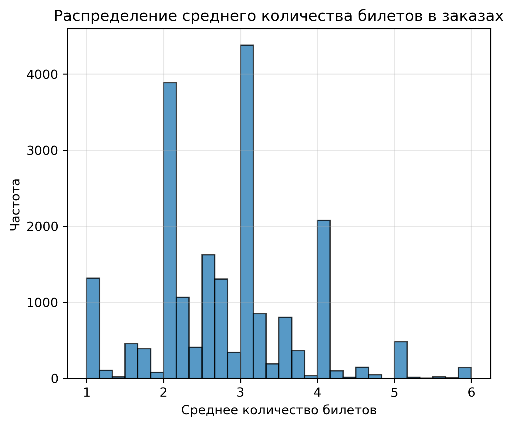
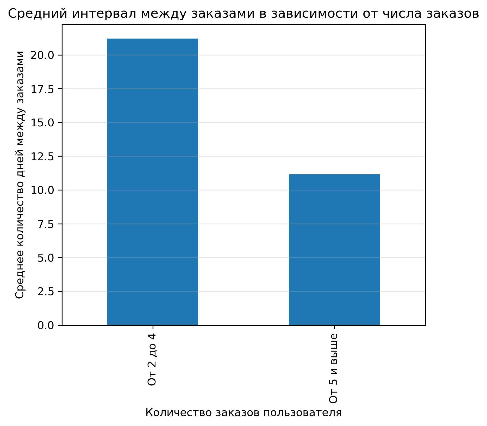

# Анализ лояльности пользователей Яндекс Афиши
Исследовательский анализ заказов Яндекс Афиши: какие характеристики первого заказа и поведения пользователя связаны с повторными покупками и риском оттока.

## Структура репозитория
```text
yandex-afisha-loyalty-analysis/
├── .gitignore
├── .env.example
├── requirements.txt
├── README.md
├── data/
    ├── raw_data-analyst-afisha.csv
    ├── processed_data-analyst-afisha.csv
    └── final_tickets_tenge_df.csv
├── notebooks/
    └── ticket_office.ipynb
```

## Цели и задачи проекта
Провести исследовательский анализ данных Яндекс Афиши, чтобы понять, какие пользователи с большей вероятностью возвращаются на платформу и делают заказы повторно.


## Данные
Источник: датасет `data-analyst-afisha`\
Объём: 290 611 заказов, 14 признаков\
Основные поля:
- `user_id` — уникальный идентификатор пользователя, совершившего заказ;
- `device_type_canonical` — тип устройства, с которого был оформлен заказ (`mobile` — мобильные устройства, `desktop` — стационарные);
- `order_id` — уникальный идентификатор заказа;
- `order_dt` — дата создания заказа (используйте данные `created_dt_msk`);
- `order_ts` — дата и время создания заказа (используйте данные `created_ts_msk`);
- `currency_code` — валюта оплаты;
- `revenue` — выручка от заказа;
- `tickets_count` — количество купленных билетов;
- `days_since_prev` — количество дней от предыдущей покупки пользователя, для пользователей с одной покупкой — значение пропущено;
- `event_id` — уникальный идентификатор мероприятия;
- `service_name` — название билетного оператора;
- `event_type_main` — основной тип мероприятия (театральная постановка, концерт и так далее);
- `region_name` — название региона, в котором прошло мероприятие;
- `city_name` — название города, в котором прошло мероприятие.


## Стек
- Python: pandas, matplotlib, seaborn
- SQL: PostgreSQL, SQLAlchemy
- Инструменты: Jupyter Notebook, Git


## Содержание проекта
1. Загрузка данных
2. Предобработка данных
3. Создание профиля пользователя
4. Исследовательский анализ данных
5. Общий вывод и рекомендации


## Ключевые результаты
- Все заказы были переведены в rub, в пересчете на дату оформления заказа;
- Для оптимизации памяти уменьшена разрядность двух целочисленных столбцов;
- Удалены 5,907 строк отрицательных и нулевых заказов;
- Выбросы в количестве 182 строк отфильтрованы по 99 процентилю;
- Средняя выручка с заказа: **582.61 rub**;
- Среднее количество билетов в заказе: **2.75**;
- Средний интервал между заказами: **17.05 дня**;
- Пользователи, купившие 2–3 билета в первом заказе, возвращаются чаще: их доля среди вернувшихся составляет **49.8%**;
- Интервал между покупками — один из главных факторов удержания: покупки примерно раз в 11 дней связаны с более высокой активностью, а интервал около 21 дня — с риском оттока;
- На количество заказов сильнее всего влияют среднее число билетов в заказе и средний интервал между покупками


## Как запустить
git clone https://github.com/yageadvert/yandex-afisha-loyalty-analysis.git \
cd yandex-afisha-loyalty-analysis\
pip install -r requirements.txt\
jupyter notebook


## Итоговые выводы
- Необходимо акцентировать внимание на сокращении интервала между покупками: стимулировать пользователей на повторные заказы каждые 11 дней;
- Пользователей с интервалом заказов более 21 дня стоит рассматривать как группу риска оттока и включать в маркетинговые кампании;
- Выявлены пользователи с аномально большим числом заказов - их поведение требует отдельного анализа как потенциальная точка роста;

## Ключевые графики




## Автор
https://github.com/yageadvert

---